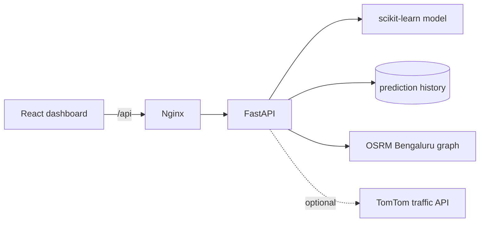

# Architecture

The frontend is a static React build served by Nginx. Nginx proxies `/api/*`
to FastAPI and removes that prefix. FastAPI owns validation, prediction
history, model inference, and route intelligence. OSRM remains the source of
route geometry, distance, and base duration. TomTom is optional: if no API key
is configured or the provider fails, route requests continue with OSRM only.

The current persistence layer is SQLite for legacy prediction history. It is
kept in a Docker volume. PostGIS, crowdsourced traces, and production traffic
forecasting require observed provider data and are intentionally not simulated.
