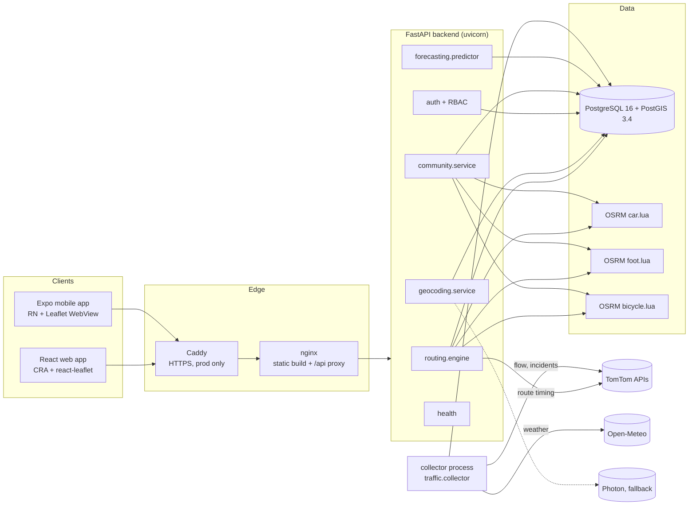

# Architecture

## System overview

## Components

| Component | Code | Responsibility |
|---|---|---|
| API app | `backend/main.py` | App factory, CORS, security headers, error envelope, routers |
| Configuration | `backend/core/settings.py` | Typed settings from env/.env; secrets as `SecretStr`; production validation |
| Logging/errors | `core/log_config.py`, `core/errors.py` | Key redaction in all log records; stable `{"error":{code,message,request_id}}` |
| Database | `db/models.py`, `db/session.py`, `migrations/` | SQLAlchemy 2 ORM, Alembic migrations, PostGIS generated geography columns |
| Routing | `routing/engine.py` + `geometry.py`, `classification.py`, `scoring.py`, `osrm_client.py`, `route_profiles.py` | Candidate generation, dedup, traffic timing, evidence, ranking, classification, explanations |
| Geocoding | `geocoding/gazetteer.py`, `service.py`, `text.py` | OSM gazetteer build; search, coordinate parsing, reverse geocoding |
| Providers | `providers/tomtom.py`, `openmeteo.py`, `quota.py` | Validated provider clients; DB-backed daily TomTom budget |
| Ingestion | `traffic/collector.py`, `ingest.py`, `state_engine.py`, `maintenance.py` | Scheduled collection, dedup, staleness, retention, daily retrain attempt |
| Weather | `weather/service.py` | Stored or live current weather, hourly forecast for future departures |
| Forecasting | `forecasting/pipeline.py`, `segment_model.py`, `predictor.py` | Chronological evaluation pipeline, registry, gated activation, serving |
| Community | `community/service.py` | GPS validation, map matching, comparison, candidate lifecycle |
| Auth | `auth/security.py`, `auth/bootstrap.py`, `api/deps.py` | bcrypt, JWT with revocation, rate limit, role checks, admin bootstrap |
| Web | `frontend/src/` | Navigate, Traffic, Account, Admin pages |
| Mobile | `mobile/` | Navigate, Traffic, Account screens on the same API |

## Request lifecycle: `POST /v1/routes`

1. Validate the body (`RouteRequestV2`); resolve the vehicle → OSRM server for that profile (503 `mode_unavailable` if absent; never substituted).
2. OSRM primary route (+ native alternatives) = **reference route**.
3. 10 corridor via-point routes in parallel (5 concurrent), snapped by OSRM.
4. Filter: detour limits, U-turn spurs; geometric dedup (symmetric overlap ≥ 0.85).
5. TomTom timing per candidate (supportingPoints; departAt for future); reject if length differs > 8 %.
6. Evidence: incidents *on* the route, monitored-point observations (+ forecast if an evaluated model is active), weather at departure.
7. Rank on one comparison basis; classify vs reference; generate explanations; optionally save the trip.

## Processes and deployment units

| Unit | Image | Notes |
|---|---|---|
| `backend` | `backend/Dockerfile` (python:3.12-slim) | Runs `alembic upgrade head` then uvicorn |
| `collector` | same image | `python -m traffic.collector`; resumes its schedule after restarts |
| `osrm-car/foot/bicycle` | `ghcr.io/project-osrm/osrm-backend` | Pre-built MLD graphs mounted read-only (~300 MB RAM each measured) |
| `postgres` | `postgis/postgis:16-3.4` | Named volume `bp_pgdata` |
| `frontend` | `frontend/Dockerfile` (node build → nginx) | `/api/*` proxied to backend |
| `caddy` | `caddy:2.8-alpine` (prod overlay) | Automatic HTTPS; the only public ports (80/443) |

See [ROUTING.md](ROUTING.md), [TRAFFIC.md](TRAFFIC.md), [ML_PIPELINE.md](ML_PIPELINE.md),
[DATABASE.md](DATABASE.md), [SECURITY.md](SECURITY.md), [DEPLOYMENT.md](DEPLOYMENT.md).
