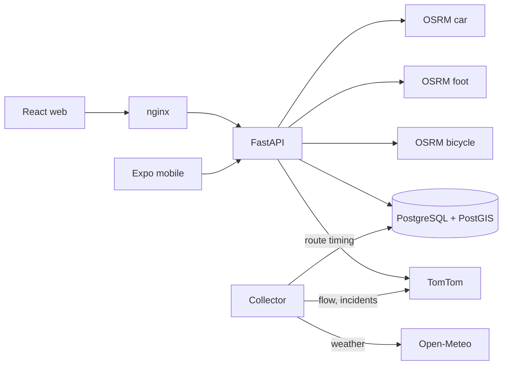

# Bengaluru Pulse V2 — Evidence-Based Route Planning and Traffic Forecasting for Bengaluru

**Major Project Phase 2 — Final Implementation Report (R4)**
Branch `v2-build`, October 2026.

---

## Abstract

Bengaluru Pulse V2 is a route-planning and traffic-intelligence system for
Bengaluru. It computes several practical routes over the full OpenStreetMap (OSM)
road network for car, motorcycle, bicycle and walking, times car and motorcycle
routes with live or predicted traffic from TomTom, labels routes as *shortcuts*
or *longcuts* against an explicit reference route, and explains every
recommendation with the data it used. The system collects real traffic, incident
and weather observations into a PostgreSQL/PostGIS database, provides user and
administrator roles, community route verification, a React web application and an
Expo mobile application, and runs as a Docker Compose stack.

The project deliberately separates *working infrastructure* from *validated
research results*. Routing, traffic timing, data collection, the evaluation
pipeline and the user-facing applications are implemented and tested (115 backend
and 7 frontend automated tests pass, plus live integration tests on the real road
graphs). Forecasting is **not yet validated**: on the public daily dataset no model
beat a simple historical-average baseline, and the system's own traffic
observations (collected since 22 October 2026) are still too few for a reliable
evaluation. A prospective prediction-versus-actual logging framework is running
so that forecasting claims can be tested on genuinely unseen data.

## 1. Introduction

Commuters in Bengaluru face heavy and variable congestion. Mainstream navigation
apps give a recommended route but rarely state where their numbers come from,
whether a time is measured or estimated, or why one route beats another. They also
offer no transparent way for local users to propose and verify shortcuts.

Bengaluru Pulse V2 rebuilds an earlier prototype (V1). V1 was a dashboard that
showed congestion "forecasts", hotspots, trends and incidents. During the Phase 0
audit, much of that content turned out to be generated from random numbers, and
its walking and cycling routes were actually car routes (see
[PROJECT_AUDIT.md](PROJECT_AUDIT.md)). V2 replaces these with real data sources,
clear provenance, and honest "unavailable" states.

## 2. Problem statement

Design and implement a system that, for any origin and destination in Bengaluru and
a chosen travel mode, departure time and preference:

1. generates several genuinely different, practical routes on the full city road network;
2. ranks them on a comparable travel-time basis using real traffic where available;
3. identifies shortcuts (shorter and faster) and longcuts (longer but faster)
   relative to a stated reference route;
4. explains each recommendation from identifiable evidence; and
5. builds the data and evaluation infrastructure needed to test whether
   traffic can be forecast better than simple baselines.

## 3. Objectives

| # | Objective | Status |
|---|---|---|
| O1 | Full-city OSM routing for car, motorcycle, bicycle, walking | Achieved (motorcycle approximated on the car graph, disclosed) |
| O2 | Diverse candidate routes beyond the routing engine's defaults | Achieved |
| O3 | Live and future-departure traffic timing per route | Achieved (TomTom; future times are TomTom's prediction) |
| O4 | Strict shortcut/longcut classification | Achieved, exhaustively tested |
| O5 | Evidence-based explanations and data-source status | Achieved |
| O6 | Automatic collection of traffic, incident and weather data | Achieved (running since 22 Oct 2026) |
| O7 | Forecasting with chronological evaluation against baselines | Pipeline achieved; **no validated model** |
| O8 | Community shortcut submission and verification | Achieved (no real submissions yet) |
| O9 | Secure user and administrator roles | Achieved |
| O10 | Web and mobile clients, Docker deployment, CI | Web achieved; mobile builds but untested on a device; local deployment only |

## 4. Scope

**In scope:** Bengaluru metropolitan area (lon 77.00–78.00, lat 12.45–13.42);
route planning (not live turn-by-turn guidance); four travel modes; one traffic
provider (TomTom free tier); weather from Open-Meteo; local Docker deployment with
a prepared single-server production configuration.

**Out of scope:** voice navigation and live re-routing while driving, public
transport, payment or commercial operation, and city-wide traffic sensing (traffic
flow is sampled at 26 monitored points).

## 5. Literature review

**Route planning on road networks.** Dijkstra's algorithm [1] is the basis of
shortest-path search, but continental-scale road graphs need speed-up techniques.
OSRM [2] provides real-time routing on OSM data; its Multi-Level Dijkstra (MLD)
mode follows the customizable route planning approach of Delling et al. [3], which
separates metric-independent preprocessing from fast customization. Producing
*alternative* routes is a distinct problem: Abraham et al. [4] define admissible
alternatives as routes with limited sharing, bounded stretch and local optimality.
OSRM's native alternatives are few in practice, which motivated our corridor-based
candidate generation and geometric deduplication.

**Map data and map matching.** OpenStreetMap [5] provides openly licensed,
community-maintained road data. Map matching of noisy GPS traces is commonly done
with hidden Markov models [6]; OSRM's matching service builds on that approach,
and we use it to validate community trips.

**Short-term traffic forecasting.** Vlahogianni et al. [7] review short-term
traffic forecasting and stress realistic evaluation and the strength of simple
benchmarks. Deep spatio-temporal models such as DCRNN [8] and STGCN [9] report
gains on dense sensor networks (e.g. hundreds of loop detectors with months of
5-minute data). Such data does not exist for this project. Forecast evaluation
literature [10, 11] emphasises out-of-sample, time-ordered evaluation; random
train/test splits of time series can overstate accuracy. This is the reason we
re-examined V1's reported R² of 0.96.

**Gap addressed.** Rather than proposing a new forecasting model, this project
contributes an end-to-end, reproducible system that (a) attributes every route
time to a source, (b) applies strict and tested route-type definitions, and (c)
evaluates forecasting honestly against baselines, including prospectively.

## 6. Methodology

### 6.1 Routing
* Three OSRM servers built from OSM with the car, foot and bicycle profiles (OSRM
  ignores the profile name in the URL, so each mode needs its own server).
* Reference route = OSRM's default route for the mode.
* Candidates = native alternatives + 10 "corridor" routes through lateral
  via-points (7–34 % of trip length), requested in parallel.
* Filters: detour limits (≤ 1.5 × reference + 1 km / + 3 min), removal of U-turn
  spurs (≥ 120 m retraced), geometric deduplication (symmetric overlap ≥ 0.85
  within 40 m).

### 6.2 Traffic timing and comparison basis
* Each candidate's own geometry is sent to TomTom (supporting points). The result
  is rejected if TomTom's route length differs by more than 8 %, which means TomTom
  timed a different road.
* Future departures use TomTom's `departAt` prediction, labelled as a provider prediction.
* Routes are compared on one basis: traffic if the reference route is traffic-timed,
  otherwise OSRM free-flow (with a warning).

### 6.3 Route classification
Against the reference, on the same time basis: **shortcut** = shorter distance
**and** shorter time; **longcut** = longer distance **and** shorter time;
otherwise **alternative**; **unclassified** if a metric is missing or the bases
differ. Differences within max(50 m, 1 %) or max(30 s, 2 %) count as equal.

### 6.4 Data collection
A collector process polls TomTom flow at 26 monitored points every 30 minutes,
TomTom incidents hourly and Open-Meteo weather every 30 minutes. Observations are
validated, de-duplicated and timestamped, under a database-enforced daily TomTom
budget (2,000 of the free 2,500 requests).

### 6.5 Forecasting evaluation
* **Offline (research track):** chronological split by target time
  (train < validation < test); persistence, seasonal-naive and historical-average
  baselines; ridge regression and gradient boosting chosen on validation and
  evaluated once on test; MAE, RMSE, sMAPE, R².
* **Activation rule:** a model is used in routing only if its test MAE is at least
  5 % below the best baseline at every horizon (with ≥ 500 test samples for the
  operational task).
* **Prospective (online) evaluation:** after every collection sweep, baseline
  forecasts for 30, 60 and 120 minutes ahead are logged using only data available
  at that moment; the observed value is attached once the target time has passed.

### 6.6 Community verification
GPS traces are cleaned (accuracy, implied-speed outliers), map-matched on the
vehicle's own graph, and compared with the reference route on a common time
basis. A shortcut candidate needs ≥ 3 independent users and consistent
classifications before it enters review, and only an administrator can verify it.

## 7. System architecture

Details: [ARCHITECTURE.md](ARCHITECTURE.md), [ROUTING.md](ROUTING.md),
[TRAFFIC.md](TRAFFIC.md), [DATABASE.md](DATABASE.md), [SECURITY.md](SECURITY.md).

## 8. Implementation

| Layer | Technology | Key modules |
|---|---|---|
| API | Python 3.12, FastAPI, Pydantic 2, SQLAlchemy 2, Alembic | `backend/routing/engine.py`, `api/*.py` |
| Data | PostgreSQL 16 + PostGIS 3.4 | 17 tables, generated geography columns, GiST and trigram indexes |
| Routing | OSRM (MLD), 3 profiles | graphs built by `infrastructure/osrm/prepare_graphs.sh` |
| Geocoding | Self-built OSM gazetteer (68,761 places) + Photon fallback | `backend/geocoding/` |
| Collection | async collector, quota guard, retention job | `backend/traffic/collector.py`, `providers/` |
| Forecasting | scikit-learn pipeline, registry, online logging | `backend/forecasting/pipeline.py`, `online.py` |
| Auth | bcrypt, revocable JWT, rate-limited login, DB-sourced roles | `backend/auth/`, `api/deps.py` |
| Web | React 19 (CRA), react-leaflet, recharts | `frontend/src/` |
| Mobile | Expo SDK 58, React Native, Leaflet WebView | `mobile/` |
| Ops | Docker Compose, Caddy (prod overlay), GitHub Actions workflows | `docker-compose*.yml`, `.github/workflows/` |

## 9. Testing

Summary (full detail in [TEST_REPORT.md](TEST_REPORT.md)):

* Backend: **115 passed** (unit tests plus live integration tests against the real
  OSRM graphs and PostGIS: five benchmark trips, mode speeds, avoid-toll,
  migrations on a fresh database).
* Frontend: **7 passed**; production build compiles.
* Mobile: typecheck clean, `expo-doctor` 20/20, Android and iOS JavaScript bundles
  build, an Android debug APK builds. **Not run on a device.**
* Live checks: browser walkthrough of the full workflow; unauthorized access returns
  401/403; failure injection (routing server down, TomTom rejecting the key,
  database and collector restarts).
* Defects found by testing and fixed: 15, including an API-key leak in V1 error
  responses and a collector configuration that would have prevented any trained
  model from being saved or loaded.

## 10. Results

Full evidence: [RESULTS_AND_LIMITATIONS.md](RESULTS_AND_LIMITATIONS.md).

* **Routing:** all five benchmark trips route correctly. OSRM alone gave 0–2
  alternatives; the engine considered 10–13 candidates per request and returned up
  to 5 geometrically distinct routes.
* **Traffic-aware recommendation (live observation, 22 Oct 2026):** Whitefield →
  Electronic City produced a shortcut (21.4 km, 66 min) against the reference route
  (24.7 km, 77 min), and a longcut (26.4 km, 71 min).
* **Forecasting, research dataset (measured):** the historical average achieved test
  MAE 15.985 (1 day ahead) and 16.008 (7 days ahead) on a 0–100 congestion scale.
  The best model (ridge) scored 16.079 / 16.097, i.e. **no improvement**. The
  dataset shows near-zero lag-1 autocorrelation (−0.008) and no weekly pattern.
* **V1 re-examined:** V1's R² of 0.96 is reproduced only when same-day traffic volume
  and speed are inputs (estimation, not forecasting); without them R² falls to 0.23.
* **Forecasting, own observations:** insufficient data; see RESULTS_AND_LIMITATIONS
  for the current, preliminary prospective counts.

## 11. Limitations

* Not publicly deployed; requires an owner-created hosting account.
* No validated forecasting model; operational evaluation needs ≥ 14 days of data.
* Traffic flow observed at 26 sample points only; TomTom is the single traffic source.
* Motorcycle routing uses the car graph; two-wheeler-specific restrictions are not modelled.
* Native mobile app not launched on a device (App Store Expo Go does not yet support SDK 58; iOS device builds need Apple signing). The web app was verified on an iPhone in Safari.
* External access is a temporary tunnel (URL changes; requires the laptop, Docker and the tunnel to keep running); permanent hosting is pending.
* No e-mail verification or password reset.
* TomTom data-storage terms not yet confirmed; collected data must not be published until they are.

## 12. Conclusion

Bengaluru Pulse V2 delivers a working, tested and reproducible route-planning
system for Bengaluru that is explicit about its evidence: routes are timed on a
comparable basis, shortcuts and longcuts follow strict definitions, and missing data
is reported rather than invented. On the forecasting question, the measured answer
so far is negative: on the available public dataset, simple baselines are as good
as the learned models. The project therefore provides the infrastructure (data
collection, chronological and prospective evaluation, an activation gate) needed to
test forecasting properly as real observations accumulate. It does not claim a
forecasting result it cannot yet support.

## References

1. E. W. Dijkstra, "A note on two problems in connexion with graphs," *Numerische Mathematik*, 1, 269–271, 1959.
2. D. Luxen and C. Vetter, "Real-time routing with OpenStreetMap data," *Proc. 19th ACM SIGSPATIAL GIS*, 2011.
3. D. Delling, A. V. Goldberg, T. Pajor and R. F. Werneck, "Customizable route planning," *Proc. SEA*, LNCS 6630, 2011.
4. I. Abraham, D. Delling, A. V. Goldberg and R. F. Werneck, "Alternative routes in road networks," *ACM Journal of Experimental Algorithmics*, 18, 2013.
5. M. Haklay and P. Weber, "OpenStreetMap: User-generated street maps," *IEEE Pervasive Computing*, 7(4), 12–18, 2008.
6. P. Newson and J. Krumm, "Hidden Markov map matching through noise and sparseness," *Proc. 17th ACM SIGSPATIAL GIS*, 2009.
7. E. I. Vlahogianni, M. G. Karlaftis and J. C. Golias, "Short-term traffic forecasting: Where we are and where we're going," *Transportation Research Part C*, 43, 3–19, 2014.
8. Y. Li, R. Yu, C. Shahabi and Y. Liu, "Diffusion convolutional recurrent neural network: Data-driven traffic forecasting," *ICLR*, 2018.
9. B. Yu, H. Yin and Z. Zhu, "Spatio-temporal graph convolutional networks: A deep learning framework for traffic forecasting," *IJCAI*, 2018.
10. R. J. Hyndman and G. Athanasopoulos, *Forecasting: Principles and Practice*, 3rd ed., OTexts, 2021.
11. C. Bergmeir and J. M. Benítez, "On the use of cross-validation for time series predictor evaluation," *Information Sciences*, 191, 192–213, 2012.
12. Project OSRM documentation — https://project-osrm.org/
13. TomTom Developer documentation (Traffic, Routing APIs) — https://developer.tomtom.com/
14. Open-Meteo API and terms — https://open-meteo.com/ ; https://open-meteo.com/en/terms
15. OpenStreetMap copyright and licence (ODbL) — https://www.openstreetmap.org/copyright
16. Geofabrik OSM extracts (India, Southern Zone) — https://download.geofabrik.de/asia/india.html
